# ER 图

以下 Mermaid 图对应迁移 `20261103000002` – `0009` 的实际表与关系。图中只列出主键、外键、唯一键和关键字段，完整列定义见各模块文档。

```mermaid
erDiagram
    ACCOUNTS ||--o| PLAYER_PROFILES : "1:1 profile"
    ACCOUNTS ||--o{ PLAYER_MODE_STATS : "per mode stats"
    ACCOUNTS ||--o{ PLAYER_IDENTITIES : "linked identities"
    ACCOUNTS ||--o{ SERVERS : "owns"
    ACCOUNTS ||--o{ RECORDS : "sets"
    ACCOUNTS ||--o{ JUMPSTATS : "sets"
    ACCOUNTS ||--o{ REPLAYS : "uploads"
    ACCOUNTS ||--o{ BANS : "is banned"

    MAPS ||--o{ MAP_VERSIONS : "has versions"
    MAPS ||--o{ MAP_COURSES : "has courses"
    MAPS ||--o{ MAP_MODES : "supports modes"
    MAPS ||--o{ SERVERS : "current map"
    MAPS ||--o{ JUMPSTATS : "happens on"
    MAPS ||--o{ REPLAYS : "replay of"

    MOVEMENT_MODES ||--o{ MAP_MODES : "allowed on"
    MOVEMENT_MODES ||--o{ COURSE_TIERS : "tier per mode"
    MOVEMENT_MODES ||--o{ RECORDS : "mode of run"
    MOVEMENT_MODES ||--o{ JUMPSTATS : "mode of jump"
    MOVEMENT_STYLES ||--o{ RECORDS : "style of run"
    MOVEMENT_STYLES ||--o{ JUMPSTATS : "style of jump"

    MAP_COURSES ||--o{ COURSE_TIERS : "ranked as"
    MAP_COURSES ||--o{ RECORDS : "run on"
    MAP_COURSES ||--o{ COURSE_WORLD_RECORDS : "WR per dimension"

    SERVERS ||--o{ RECORDS : "submits"
    SERVERS ||--o{ JUMPSTATS : "submits"
    SERVERS ||--o{ BANS : "issues"

    JUMP_TYPES ||--o{ JUMPSTATS : "type of"

    RECORDS ||--o{ RECORD_HISTORY : "audited by"
    RECORDS ||--o{ REPLAYS : "has replays"
    RECORDS ||--o{ COURSE_WORLD_RECORDS : "can hold WR"

    BANS ||--o| BAN_REVOCATIONS : "revoked by"

    ACCOUNTS {
        bigint id PK
        numeric steam_id64 UK "uint64 as NUMERIC(20,0)"
        text steam_id2
        timestamptz created_at
        timestamptz deleted_at
    }

    PLAYER_PROFILES {
        bigint account_id PK,FK
        text display_name
        text country
        inet last_ip
        jsonb preferences
        boolean prime_verified
        timestamptz last_joined_at
    }

    PLAYER_MODE_STATS {
        bigint account_id PK,FK
        smallint mode_id PK,FK
        integer points
        integer points_overall
        numeric rating
        integer finishes
    }

    PLAYER_IDENTITIES {
        bigint id PK
        bigint account_id FK
        text provider
        text identifier UK
        timestamptz verified_at
    }

    MAPS {
        bigint id PK
        text name UK
        bigint workshop_id UK
        text status
        timestamptz approved_at
        timestamptz deleted_at
    }

    MAP_VERSIONS {
        bigint id PK
        bigint map_id FK
        bigint file_size_bytes
        bytea checksum
        text checksum_algorithm
        boolean is_current
    }

    MAP_COURSES {
        bigint id PK
        bigint map_id FK
        smallint stage UK
        text name
    }

    MAP_MODES {
        bigint map_id PK,FK
        smallint mode_id PK,FK
    }

    COURSE_TIERS {
        bigint course_id PK,FK
        smallint mode_id PK,FK
        smallint nub_tier
        smallint pro_tier
        text status
    }

    SERVERS {
        bigint id PK
        text name UK
        inet ip UK
        integer port UK
        bigint owner_account_id FK
        bytea api_key_hash UK
        text plugin_version
        bigint current_map_id FK
        boolean is_online
        timestamptz last_heartbeat_at
        timestamptz deleted_at
    }

    RECORDS {
        bigint id PK
        bigint account_id FK
        bigint map_id FK
        bigint course_id FK
        smallint mode_id FK
        smallint style_id FK
        bigint server_id FK
        smallint tickrate
        integer teleports
        text time_type
        bigint time_ns
        text status
        text source
        uuid submission_id UK
        text external_ref UK
        timestamptz created_at
        timestamptz deleted_at
    }

    RECORD_HISTORY {
        bigint id PK
        bigint record_id FK
        text action
        text old_status
        text new_status
        bigint old_time_ns
        bigint new_time_ns
        bigint changed_by_account_id FK
        timestamptz created_at
    }

    COURSE_WORLD_RECORDS {
        bigint course_id PK,FK
        smallint mode_id PK,FK
        smallint style_id PK,FK
        text time_type PK
        bigint record_id FK
        bigint time_ns
        timestamptz achieved_at
    }

    JUMPSTATS {
        bigint id PK
        bigint account_id FK
        bigint map_id FK
        bigint server_id FK
        smallint mode_id FK
        smallint style_id FK
        smallint jump_type_id FK
        numeric distance_units
        smallint strafe_count
        numeric sync_percent
        bigint airtime_ns
        smallint tickrate
        text source
        uuid submission_id UK
        jsonb raw_metrics
        timestamptz deleted_at
    }

    JUMP_TYPES {
        smallint id PK
        text code UK
        smallint gokz_code UK
        smallint cs2kz_code UK
    }

    MOVEMENT_MODES {
        smallint id PK
        text code UK
        text display_name
    }

    MOVEMENT_STYLES {
        smallint id PK
        text code UK
        text display_name
    }

    REPLAYS {
        bigint id PK
        bigint record_id FK
        bigint account_id FK
        bigint map_id FK
        text storage_provider
        text bucket UK
        text object_key UK
        bigint size_bytes
        bytea checksum_sha256
        smallint replay_format_version
        text status
        timestamptz uploaded_at
        timestamptz expires_at
        timestamptz deleted_at
    }

    BANS {
        bigint id PK
        bigint account_id FK
        inet ip
        text ban_type
        text reason
        text stats
        bigint issued_by_account_id FK
        bigint issued_by_server_id FK
        timestamptz issued_at
        timestamptz expires_at
        text status
        text source
        text external_ref UK
    }

    BAN_REVOCATIONS {
        bigint id PK
        bigint ban_id FK,UK
        bigint revoked_by_account_id FK
        bigint revoked_by_server_id FK
        text reason
        timestamptz revoked_at
    }
```

## 图例与说明

- `PK` 主键，`FK` 外键，`UK` 唯一（部分唯一索引在图中标注为 UK，实际带 `WHERE deleted_at IS NULL` 等谓词）。
- `RECORDS.time_type` 与 `teleports` 由 CHECK 约束保证一致（PRO ⇔ 0 传送）。
- `COURSE_WORLD_RECORDS` 的主键是（关卡, 模式, 风格, TP/PRO），每个维度只保留当前 WR；通过条件 upsert 保证慢成绩不覆盖快成绩。
- `SERVERS.ip` / `SERVERS.port` 的唯一约束是组合（`ip, port`），图中分别标注以表达列参与唯一键。
- `REPLAYS.bucket` / `object_key` 的唯一约束是组合（`bucket, object_key`）。
- 阶段 1 的 `system_events` / `app_settings` 与业务表无外键关系，未在图中展开。
- 外键删除行为：
  - 级联删除：`player_profiles`、`player_mode_stats`、`player_identities`、`map_versions`、`map_courses`、`map_modes`、`course_tiers`、`record_history`、`course_world_records`、`replays`、`ban_revocations`（跟随父行）。
  - `SET NULL`：`servers.current_map_id`、`records.server_id`、`jumpstats.server_id`、审核/操作者字段。
  - 默认 `RESTRICT`：`records.account_id/map_id/course_id/mode_id/style_id`、`bans.account_id` 等，防止误删历史。
